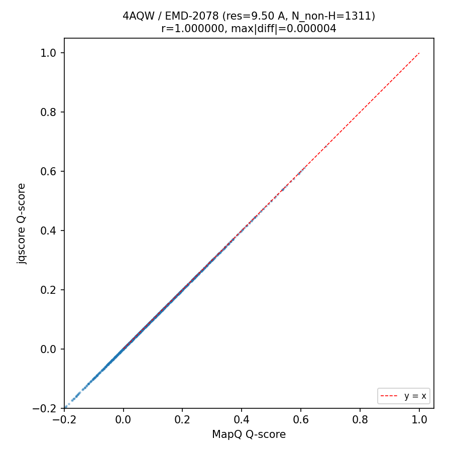
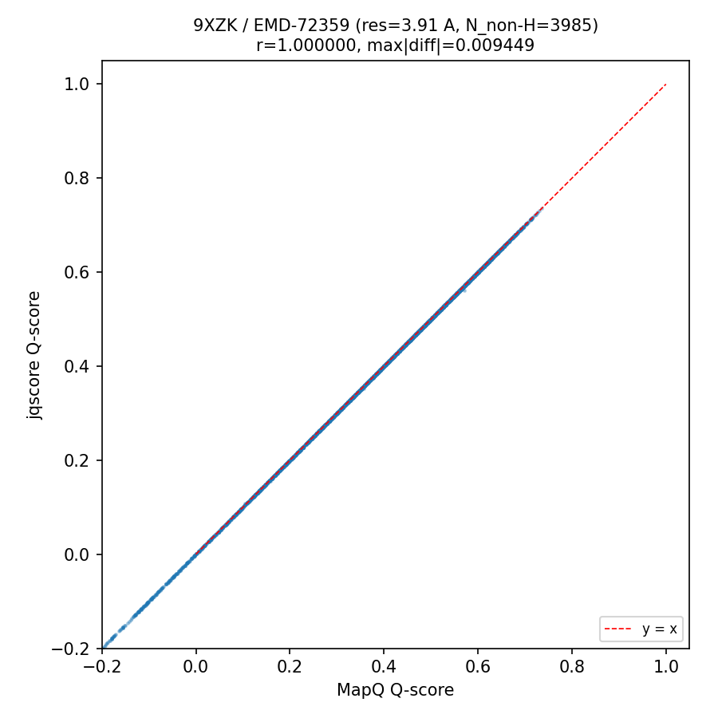
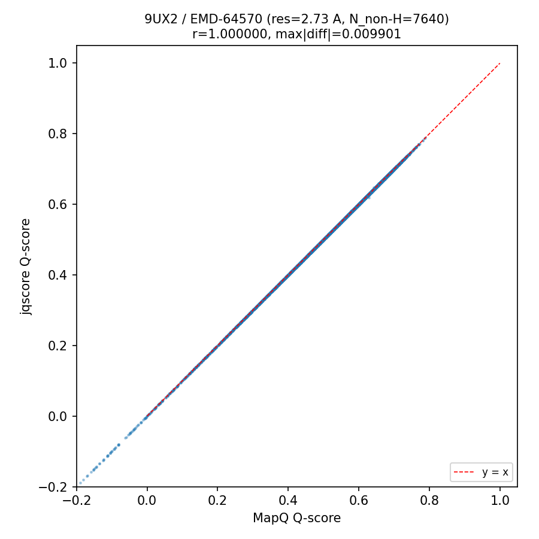
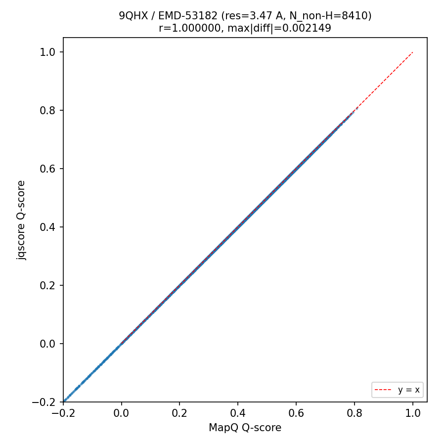
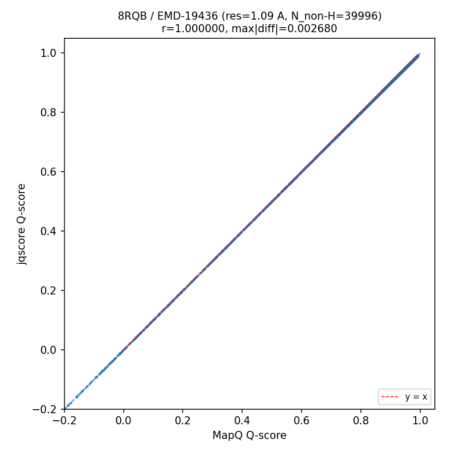
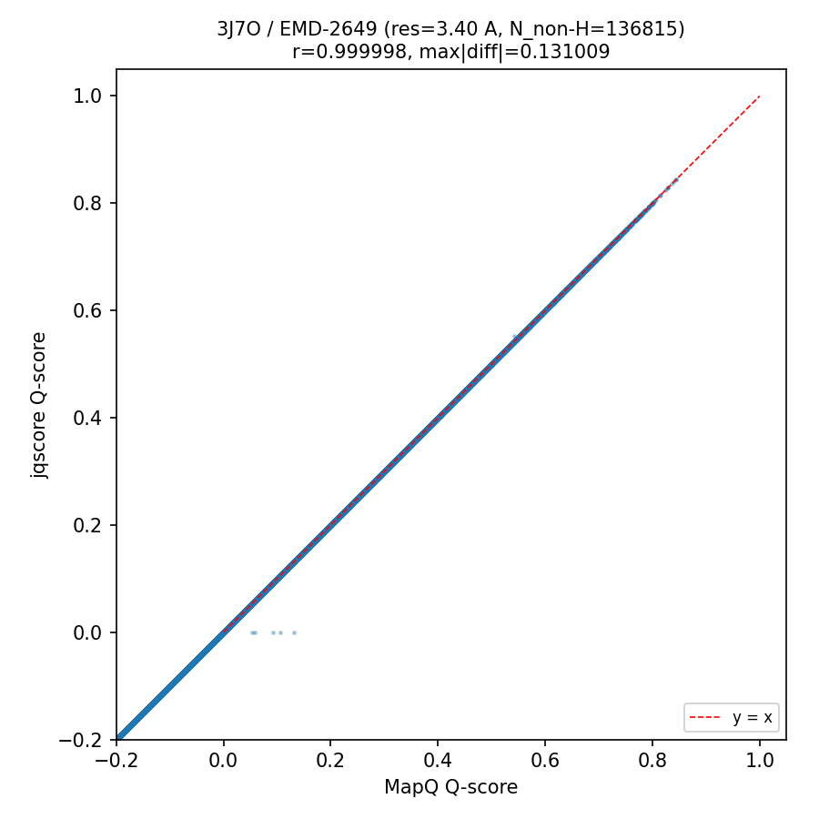
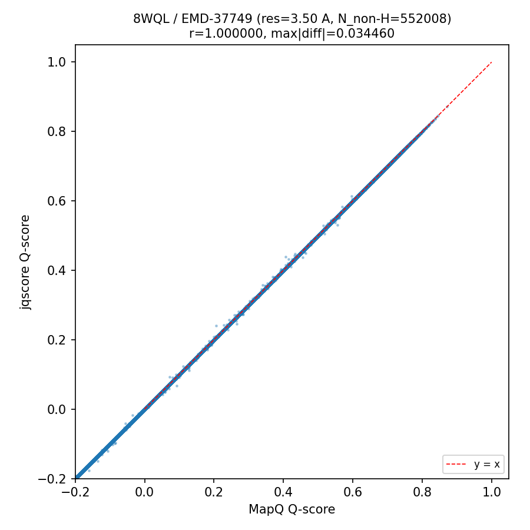
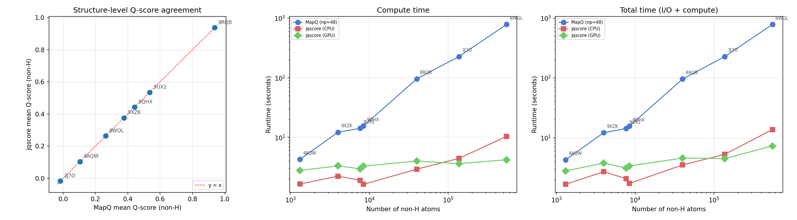

# jqscore vs MapQ Benchmark Summary

**Date:** 2026-10-28  
**Structures:** 7  
**sigma:** 0.4  

## Hardware

| Component | Details |
|-----------|---------|
| CPU | Intel(R) Xeon(R) Silver 4214R CPU @ 2.40GHz |
| CPU sockets / cores / threads | 2 / 24 / 48 |
| GPU | NVIDIA RTX A4000 |
| MapQ np | 48 |

## Accuracy

| Metric | Min | Mean | Max |
|--------|-----|------|-----|
| Pearson r | 0.999998 | 1.000000 | 1.000000 |
| Max \|diff\| | 0.000004 | 0.023178 | 0.131009 |

## Per-structure results

| PDB | EMDB | Res (A) | Non-H atoms | r | mean diff | max \|diff\| | MapQ (s) | CPU compute (s) | CPU total (s) | GPU compute (s) | GPU total (s) |
|-----|------|---------|-------------|---|-----------|-------------|----------|-----------------|---------------|-----------------|---------------|
| 4AQW | EMD-2078 | 9.50 | 1311 | 1.000000 | 0.000000 | 0.000004 | 4.3 | 1.6 | 1.7 | 2.8 | 2.8 |
| 9XZK | EMD-72359 | 3.91 | 3985 | 1.000000 | -0.000000 | 0.000025 | 12.1 | 2.2 | 2.7 | 3.3 | 3.8 |
| 9UX2 | EMD-64570 | 2.73 | 7640 | 1.000000 | 0.000000 | 0.000019 | 14.2 | 1.9 | 2.1 | 3.0 | 3.1 |
| 9QHX | EMD-53182 | 3.47 | 8410 | 1.000000 | 0.000000 | 0.002149 | 15.6 | 1.6 | 1.7 | 3.3 | 3.4 |
| 8RQB | EMD-19436 | 1.09 | 39996 | 1.000000 | -0.000000 | 0.000027 | 96.1 | 2.9 | 3.5 | 4.0 | 4.6 |
| 3J7O | EMD-2649 | 3.40 | 136815 | 0.999998 | -0.000003 | 0.131009 | 227.1 | 4.4 | 5.3 | 3.6 | 4.5 |
| 8WQL | EMD-37749 | 3.50 | 552008 | 1.000000 | -0.000000 | 0.029013 | 786.4 | 10.4 | 13.7 | 4.2 | 7.3 |

## Plots

### 4AQW

### 9XZK

### 9UX2

### 9QHX

### 8RQB

### 3J7O

### 8WQL

### Summary

